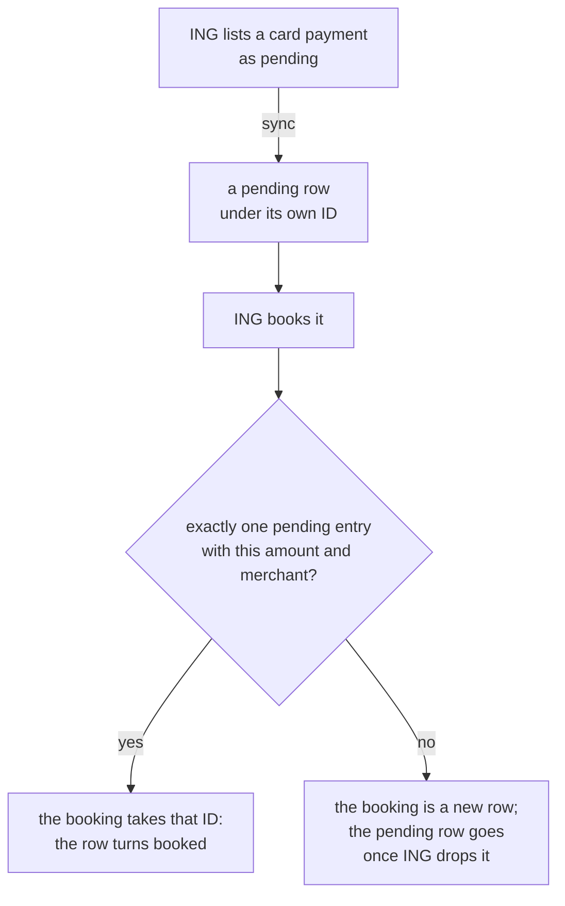

# ING Germany (FinTS) for Securo

A read-only [Securo](https://github.com/securo-finance/securo) plugin (Securo 0.20.0 or later) for ING Germany, over FinTS:

- **Girokonto** with its booked and **pending** (vorgemerkte) entries, and the balance the ING app shows: booked plus pending.
- **Extra-Konten** with their balance and entries.
- **Direkt-Depot positions** as holdings: ISIN, name, units, ING's current price and value, and the amount invested (units × ING's average buy-in).
- **Entries as the ING app lists them**: the counterparty's name as the description, the full purpose text in the notes, where Securo's search and rules find it (see [Names and notes](#names-and-notes)).

It talks only to `fints.ing.de`, through Securo's egress proxy. It cannot make payments or transfers: the code has no call for them.

## Before you start

### A FinTS product registration

Every program that uses FinTS must be registered with the Deutsche Kreditwirtschaft, a script for yourself included. The registration is free, and you need your own: this plugin ships none.

1. Download the registration form from [fints.org → Produktregistrierung](https://www.fints.org/de/hersteller/produktregistrierung).
2. Fill it in as the owner yourself, as a private person. For the product's category, choose **Web-Server**: the plugin runs unattended on your Securo server. The vendor mailing list on page 2 can be declined.
3. Send it by e-mail to the address the form names (`registrierung@hbci-zka.de` at the time of writing).
4. You get a **product registration number** by e-mail. It can take from a few days to several weeks. Keep it with your ING credentials, in a password manager.

### ING

- Your ING login (Zugangsnummer) and internet banking PIN.
- A login in ING's own online banking within the last 90 days: ING requires it for FinTS access.
- Securo with plugins enabled, including the plugin runner and egress proxy ([Securo's bank provider guide](https://github.com/securo-finance/securo/blob/main/docs/plugins/bank-provider-plugins.md)).

## Setting it up

1. In Securo, open **Plugins → Catalog**, find **ING Germany (FinTS)**, review the network access it asks for, and install it.
2. Create a connection with your login, PIN and product registration number.
3. Optionally enter the IBANs to sync, separated by commas; empty means every account ING lists. Depots are read only if they are in that list (or the list is empty).
4. On Securo 0.21.0 or older, turn **Import pending transactions** off in the connection's settings (see [Pending entries](#pending-entries)). The balance still includes them.
5. Run the first sync and compare balances, a few entries and the depot positions with the ING app.

### Settings

| Setting               | Default |                                                                                                                                                                                 |
| --------------------- | ------- | ------------------------------------------------------------------------------------------------------------------------------------------------------------------------------- |
| IBANs to sync         | all     | Complete IBANs, comma-separated. An IBAN ING doesn't list fails the sync.                                                                                                       |
| Days of history       | 85      | 1 to 89. FinTS reaches back about 90 days; later syncs start where Securo asks.                                                                                                 |
| Read depot positions  | yes     | `no` leaves the holdings Securo has untouched.                                                                                                                                  |
| Purpose text in notes | no      | `yes` on a Securo that takes notes from plugins ([securo#1833](https://github.com/securo-finance/securo/pull/1833)); with `no` the purpose follows the name in the description. |

## Names and notes

| Field       | What lands there                                                                                                      | Example                                                                                                                   |
| ----------- | --------------------------------------------------------------------------------------------------------------------- | ------------------------------------------------------------------------------------------------------------------------- |
| Description | the name the ING app lists, without an IBAN or account number glued to it and without `VISA`                          | `BAUMARKT MUSTER`, `Kleingeld Plus - Sparen`, `PayPal Europe S.a.r.l. et Cie S.C.A`; pending: `Musikdienst · Musterstadt` |
| Payee       | the same name, without a card terminal's order reference or a payment provider's prefix, so one merchant is one payee | `AMZN MKTP DE*AB12CD34E` → `AMZN MKTP DE`, `PAYPAL *NEWS ONLINE` → `NEWS ONLINE`                                          |
| Notes       | ING's whole purpose text, only whitespace collapsed                                                                   | the PayPal merchant, an order number, `Miete`                                                                             |

The description is what you read in the list; the notes hold everything else ING sends, so a search for an order number or a reference finds the entry, and Securo's rules can match on it. An entry ING lists without a name (a securities trade, the closing of a statement) is described by its own words, for example `Kauf <security> (<ISIN>)`. With **Purpose text in notes** set to `no`, the purpose follows the name in the description instead.

On a Securo with [securo#1834](https://github.com/securo-finance/securo/pull/1834), entries already imported take a later release's names and notes on their next sync, unless you edited them.

## Pending entries



Most card payments take the left path: their row simply turns booked, and what you set on it stays.

ING's booked entry carries a different date and text than its pending form, and no reference to it. So the plugin remembers each sync's pending entries, and when a booking has the same amount and merchant as exactly one of them (booked on or within ten days after the purchase), it gets that entry's ID. The row keeps the pending entry's text and date, the day of the purchase. When that isn't certain (two equal purchases at one shop), the booking comes in as a new row, and the pending row has to be removed once ING stops listing it.

Securo removes such a row only for a plugin that declares a **complete feed**: every sync returns every booked entry of the window and every current pending one, which this plugin does. Securo 0.21.0 and older can't take that declaration ([securo#1728](https://github.com/securo-finance/securo/pull/1728) adds it, and [securo#1772](https://github.com/securo-finance/securo/pull/1772) removes the row on the next sync rather than after a week; both are merged and wait for a release). This plugin declares it in the release that requires that Securo. Until then, keep **Import pending transactions** off: rows of cancelled or unmatched pending entries would stay. The balance still includes pending amounts, as the ING app does, so it won't equal the sum of the listed entries.

## What it doesn't do

- **No depot history.** ING offers no depot transactions over FinTS, so positions come without their trades, and a position's chart starts on the first sync. Buys do appear on the Girokonto ("Kauf <security> (<ISIN>)"), but with the amount only, no units or price, and only for the last 85 days.
- **No app approval inside a sync.** If ING asks for an approval in its app (or a strong customer authentication, code 9075), the connection pauses ("needs attention"). Log in to ING's online banking once, then sync again.
- **No loans, no Rahmenkredit:** ING doesn't list them over FinTS at all, so they can't come in through this plugin.

## Safety

- **Read-only by construction**: the only calls are the account list, bank information, balances, statements and depot statements (`ing_fints/client.py`).
- **Fails closed**: an answer the plugin can't read fails the whole sync, and Securo keeps what it has. A depot position in a shape the plugin doesn't know fails it too; set **Read depot positions** to `no` to sync the accounts meanwhile, and report the shape (not the data) in an issue.
- **Nothing of yours in messages or logs**: error messages are fixed texts with at most FinTS's four-digit response codes; they never carry IBANs, names, amounts or bank answers, and python-fints' own logging (which writes bank answers) is switched off. Login, PIN, registration number and IBAN selection are Securo plugin secrets.
- IDs are salted hashes per connection: no IBAN appears in an account or transaction ID. Don't delete and recreate a connection without need: a new one gets new IDs.

## Development

Securo's plugin runner runs Python 3.14, and so does this code.

```sh
uv sync
uv run pytest -q
uv run ruff check && uv run ruff format --check
```

`requirements.txt` is what Securo's runner installs; after a change to `uv.lock`, regenerate it with `uv export --frozen --no-dev --no-emit-project --no-header --format requirements-txt > requirements.txt`. Decisions are in [`docs/adr/`](https://github.com/marceltov/securo-ing-fints/tree/main/docs/adr).

## Other Securo plugins

- [Trade Republic](https://github.com/marceltov/securo-trade-republic): the cash account, depot positions and every trade of each position, from the Trade Republic app's own login (no FinTS registration).

## License

[MIT](https://github.com/marceltov/securo-ing-fints/blob/main/LICENSE). The `fints` library it uses is LGPL-3.0-or-later.
