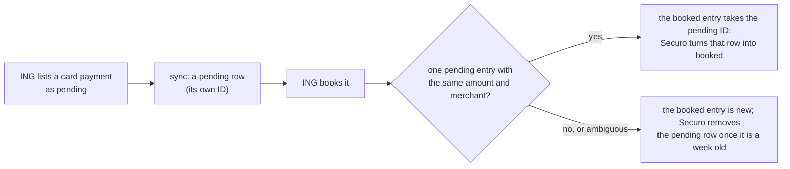

# ING Germany (FinTS) for Securo

A read-only [Securo](https://github.com/securo-finance/securo) plugin (Securo 0.20.0 or later) for ING Germany, over FinTS:

- **Girokonto** with its booked and **pending** (vorgemerkte) entries, and the balance the ING app shows: booked plus pending.
- **Extra-Konten** with their balance and entries.
- **Direkt-Depot positions** as holdings: ISIN, name, units, ING's current price and value, and the amount invested (units × ING's average buy-in).
- **Readable payees and descriptions**: no IBANs or account numbers glued to names, no card references; a card payment reads as "merchant · town", a securities trade as "Kauf <security> (<ISIN>)".

It talks only to `fints.ing.de`, through Securo's egress proxy. It cannot make payments or transfers: the code has no call for them.

## Before you start

### A FinTS product registration

Every program that uses FinTS must be registered with the Deutsche Kreditwirtschaft, a script for yourself included. The registration is free, and you need your own: this plugin ships none.

1. Download the registration form from [fints.org → Produktregistrierung](https://www.fints.org/de/hersteller/produktregistrierung).
2. Fill it in as the owner yourself, as a private person. For the product's category, choose **Web-Server**: the plugin runs unattended on your Securo server. The vendor mailing list on page 2 can be declined.
3. Send it by e-mail to the address the form names (`registrierung@hbci-zka.de` at the time of writing).
4. You get a **product registration number** by e-mail. It can take from a few days to several weeks. Keep it with your ING credentials, in a password manager.

### ING

- Your ING login (Zugangsnummer) and internet banking PIN.
- A login in ING's own online banking within the last 90 days: ING requires it for FinTS access.
- Securo with plugins enabled, including the plugin runner and egress proxy ([Securo's bank provider guide](https://github.com/securo-finance/securo/blob/main/docs/plugins/bank-provider-plugins.md)).

## Setting it up

1. In Securo, open **Plugins → Catalog**, find **ING Germany (FinTS)**, review the network access it asks for, and install it.
2. Create a connection with your login, PIN and product registration number.
3. Optionally enter the IBANs to sync, separated by commas; empty means every account ING lists. Depots are read only if they are in that list (or the list is empty).
4. Leave **Import pending transactions** on (Securo's default) to see pending entries, if your Securo vouches for this plugin's complete feed (see below); otherwise turn it off.
5. Run the first sync and compare balances, a few entries and the depot positions with the ING app.

### Settings

| Setting | Default | |
|---|---|---|
| IBANs to sync | all | Complete IBANs, comma-separated. An IBAN ING doesn't list fails the sync. |
| Days of history | 85 | 1 to 89. FinTS reaches back about 90 days; later syncs start where Securo asks. |
| Read depot positions | yes | `no` leaves the holdings Securo has untouched. |

## Pending entries



A pending entry is imported under its own ID. When ING books it, its booked form carries a different date and text and no reference to the pending one. The plugin remembers each sync's pending entries; when a booked entry has the same amount and merchant as exactly one pending entry, and was booked on or within ten days after the purchase, it gets that pending entry's ID, and Securo turns the row into a booked one in place. The row keeps the pending entry's text and date (the day of the purchase).

When that isn't certain (two equal purchases at the same shop), the booked entry is imported as new, and Securo deletes the pending row once ING no longer lists it, which Securo does only for a row at least a week old. For those few days both show.

That deletion needs a Securo that trusts the plugin's feed to be **complete** (every sync returns all booked entries of the window and all current pending ones). Until a Securo release reads that from the plugin's manifest, the operator vouches for it with `PLUGINS_COMPLETE_FEED=marceltov/securo-ing-fints`. Without it, turn **Import pending transactions** off. The balance still includes pending amounts then, as the ING app does, so it won't equal the sum of the listed entries.

## What it doesn't do

- **No depot history.** ING offers no depot transactions over FinTS, so positions come without their trades, and a position's chart starts on the first sync.
- **No app approval inside a sync.** If ING asks for an approval in its app (or a strong customer authentication, code 9075), the connection pauses ("needs attention"). Log in to ING's online banking once, then sync again.
- **No loans, no Rahmenkredit:** ING doesn't list them over FinTS at all, so they can't come in through this plugin.

## Safety

- **Read-only by construction**: the only calls are the account list, bank information, balances, statements and depot statements (`ing_fints/client.py`).
- **Fails closed**: an answer the plugin can't read fails the whole sync, and Securo keeps what it has. A depot position in a shape the plugin doesn't know fails it too; set **Read depot positions** to `no` to sync the accounts meanwhile, and report the shape (not the data) in an issue.
- **Nothing of yours in messages or logs**: error messages are fixed texts with at most FinTS's four-digit response codes; they never carry IBANs, names, amounts or bank answers, and python-fints' own logging (which writes bank answers) is switched off. Login, PIN, registration number and IBAN selection are Securo plugin secrets.
- IDs are salted hashes per connection: no IBAN appears in an account or transaction ID. Don't delete and recreate a connection without need: a new one gets new IDs.

## Development

Securo's plugin runner runs Python 3.14, and so does this code.

```sh
uv sync
uv run pytest -q
uv run ruff check && uv run ruff format --check
```

`requirements.txt` is what Securo's runner installs; after a change to `uv.lock`, regenerate it with `uv export --frozen --no-dev --no-emit-project --no-header --format requirements-txt > requirements.txt`. Decisions are in [`docs/adr/`](docs/adr/).

## Other Securo plugins

- [Trade Republic](https://github.com/marceltov/securo-trade-republic): the cash account, depot positions and every trade of each position, from the Trade Republic app's own login (no FinTS registration).

## License

[MIT](LICENSE). The `fints` library it uses is LGPL-3.0-or-later.
