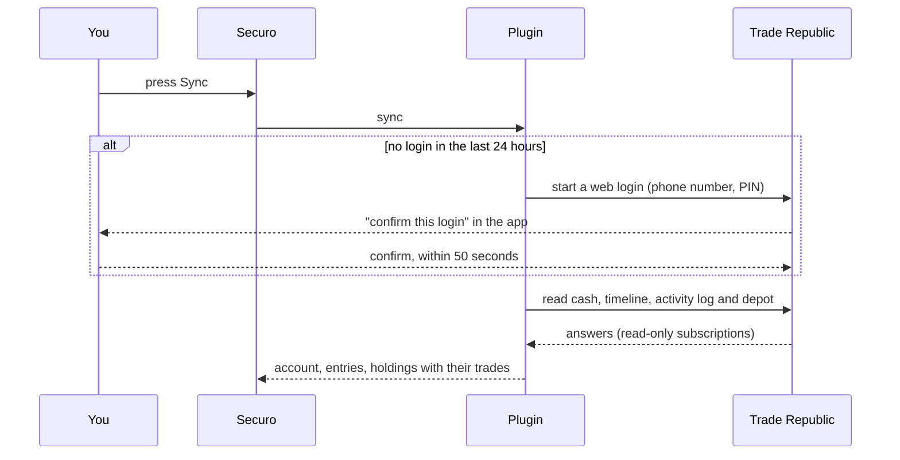

# Trade Republic for Securo

A read-only [Securo](https://github.com/securo-finance/securo) plugin (Securo 0.20.0 or later) for a Trade Republic account:

- **Cash account** with its balance and transactions from the Trade Republic timeline, with the merchant or counterparty as payee (card payments, transfers, interest, dividends, savings plan executions). Booked and pending entries are imported; cancelled, deleted and hidden ones are not.
- **Depot positions** as holdings: ISIN, name, units, the current price from Trade Republic and the amount invested (units × average buy-in).
- **Every buy and sale** of each position (orders, savings plan runs, Saveback and round-ups) with its execution date, units, price and fee. Securo keeps them as the position's ledger (cost basis per order, realized gains); from the release with [securo#1753](https://github.com/securo-finance/securo/pull/1753) (merged, not yet released) it also draws the position's chart from them, from the first buy. Cancelled and failed orders are not trades.
- **Units that came in another way**, from Trade Republic's activity log: free shares (a buy at Trade Republic's price) and transfers of securities from another bank (a buy on the day Trade Republic received them; a transfer carries no price, so it is priced from the position's average buy-in in Trade Republic, which keeps the invested amount as the app shows it).

Every number comes from Trade Republic: no other market data source is used.

A timeline event that changes units in a way the plugin does not map yet (a transfer of securities out, a share bonus, an IPO allocation, a corporate action paid in shares) fails the sync with a message naming it, and so does a held position whose trades don't add up to its units, rather than leaving a history that doesn't add up. A sold-out position whose trades don't come to zero (a stock split Trade Republic doesn't list) comes in without history. Trades already read are remembered in the connection's state, so only new ones are read in detail on later syncs.

It talks only to `api.traderepublic.com`, through Securo's egress proxy.

## How syncing works



A confirmation on your phone comes only right after you pressed Sync, and at most once a day.

Trade Republic has no official API. This plugin uses the same web login as `app.traderepublic.com`:

1. You enter the phone number and PIN of your Trade Republic account.
2. On a sync, the plugin starts a login and Trade Republic asks you to **confirm it in the Trade Republic app**. The plugin waits up to 50 seconds for that.
3. The login lasts **24 hours**. Every sync within those 24 hours reuses it; after that, the next sync asks for a confirmation again.

That is why the plugin has **no schedule**: Securo syncs it only when you press **Sync** (and once right after you create the connection), so a confirmation never arrives on your phone unasked. If you miss the confirmation, the connection says so; press Sync again.

Accounts that confirm logins with an authenticator code instead of the app are not supported.

No FinTS registration is needed: Trade Republic has no FinTS, and the plugin uses the app's own login.

## Pending entries

A pending entry keeps its ID when Trade Republic books it, so Securo turns the row booked in place. An entry Trade Republic cancels leaves the timeline; Securo removes its row only for a plugin that declares a complete feed, which this one can from the Securo release with [securo#1728](https://github.com/securo-finance/securo/pull/1728); with [securo#1772](https://github.com/securo-finance/securo/pull/1772) the row goes on the next sync rather than a week later (both merged, not yet released). On Securo 0.21.0 and older, a cancelled pending entry stays until you delete it.

## Safety

- **Read-only by construction.** The client can subscribe to `cash`, `compactPortfolioByType`, `timelineTransactions`, `timelineActivityLog`, `timelineDetailV2`, `instrument` and `ticker` only (`ALLOWED_SUBSCRIPTIONS` in `trade_republic/client.py`); there is no code for orders, savings plans or payouts.
- **The login itself is not read-only.** A Trade Republic web session can trade. Securo keeps it in the connection's sealed secrets; treat your Securo server accordingly.
- **Fails closed.** An answer this plugin does not recognise fails the sync; it never reports an empty list (Securo would archive what it already has).
- Error messages never carry the phone number, PIN, session or account number, and the logs of the libraries it uses (websockets, requests) are switched off: they can carry what Trade Republic sent.

## Development

Securo's plugin runner runs Python 3.14, and so does this code.

```sh
uv sync
uv run pytest -q
uv run ruff check && uv run ruff format --check
```

`requirements.txt` is what Securo's runner installs; after a change to `uv.lock`, regenerate it with `uv export --frozen --no-dev --no-emit-project --no-header --format requirements-txt > requirements.txt`. Decisions are in [`docs/adr/`](https://github.com/marceltov/securo-trade-republic/tree/main/docs/adr).

The login and websocket protocol follow [pytr](https://github.com/pytr-org/pytr) (MIT), reduced to what a read-only sync needs.

## Other Securo plugins

- [ING Germany (FinTS)](https://github.com/marceltov/securo-ing-fints): Girokonto with pending entries, Extra-Konten and Direkt-Depot positions. It needs a FinTS product registration; its README says how to get one.

## License

[MIT](https://github.com/marceltov/securo-trade-republic/blob/main/LICENSE)
